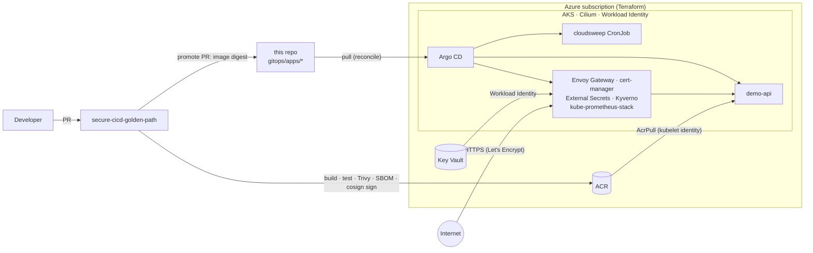

# azure-aks-gitops-platform

A production-shaped Kubernetes platform on Azure: **Terraform** builds the cloud
foundation, **Argo CD** reconciles everything that runs inside the cluster from
this repository, and no long-lived secret exists anywhere — not in the cluster,
not in CI, not in Terraform state.

It is one of three repositories that work together:

| Repo | Role |
|---|---|
| **azure-aks-gitops-platform** (this one) | Infrastructure + cluster add-ons + desired state of every app |
| [secure-cicd-golden-path](https://github.com/gastonhp1/secure-cicd-golden-path) | Builds, scans, signs and promotes images into this repo |
| [cloudsweep](https://github.com/gastonhp1/cloudsweep) | FinOps scanner that runs on this platform as a CronJob |

## Architecture



**How a change reaches production**

1. A commit to `demo-api` in *secure-cicd-golden-path* builds an image, scans it, generates
   an SBOM and signs it with Sigstore keyless (identity = the workflow itself).
2. The promote job opens a PR here that changes only the image **digest** in
   `gitops/apps/demo-api/values-<env>.yaml`. Prod requires an approved GitHub environment.
3. Argo CD syncs the change. Kyverno verifies the signature at admission
   (audit in dev, **enforce** in prod) — an image not built by that pipeline does not run.

## What's in here

```
terraform/
  bootstrap/            remote state (Entra ID auth, versioning, delete lock)
  modules/              network · aks · acr · keyvault · federated-identity
  stacks/platform/      composition of the modules (one per environment)
  envs/{dev,prod}/      thin roots: backend + sizing decisions only
gitops/
  bootstrap/            Argo CD install values + app-of-apps root
  addons/               platform add-ons as Argo CD Applications (pinned versions)
  config/               Gateway, issuers, secret store, Kyverno policies (base + overlays)
  clusters/{local,dev,prod}/   what each cluster runs; the root app points here
  apps/demo-api/        per-environment values (image digests live here)
charts/demo-api/        hardened Helm chart for the reference workload
docs/                   ADRs, security model, cost estimates
```

## Design highlights

- **Zero static credentials.** AKS Workload Identity for in-cluster workloads,
  GitHub OIDC for CI, Entra ID auth for the Terraform backend (`shared_access_key_enabled = false`).
  Local AKS accounts are disabled; access is Entra ID + Azure RBAC only. → [ADR-0003](docs/adr/0003-no-static-credentials.md)
- **Clear ownership boundary.** Terraform owns Azure resources; Argo CD owns everything inside
  the cluster, including itself. → [ADR-0001](docs/adr/0001-terraform-and-gitops-boundary.md)
- **Gateway API, not Ingress.** ingress-nginx was retired in March 2026; the platform uses
  Envoy Gateway with a single shared `Gateway` owned by the platform and `HTTPRoute`s owned by apps.
  → [ADR-0002](docs/adr/0002-gateway-api-envoy.md)
- **Supply chain enforced at runtime**, not only in CI: Kyverno `verifyImages` with keyless
  attestors pinned to the exact reusable workflow. → [ADR-0004](docs/adr/0004-admission-verified-images.md)
- **Network:** Azure CNI Overlay + Cilium data plane and network policy (no kube-proxy);
  default-deny ingress per app.
- **Hardened workload chart:** restricted PSS, read-only rootfs, non-root, digest pinning,
  HPA + PDB, zone/host topology spread, startup/readiness/liveness probes, ServiceMonitor.
- **Cost awareness:** dev runs on a Free control plane and one autoscaled node; Log Analytics has a
  daily cap. Estimates in [docs/cost.md](docs/cost.md).

## Quick start

### 1. Local, no Azure account needed (~10 min)

Requires Docker, [kind](https://kind.sigs.k8s.io/), kubectl, helm and envsubst.

```bash
make local-up        # kind cluster + Argo CD + every add-on, pulled from this repo
kubectl -n argocd get applications -w
make local-forward   # then open https://demo.127.0.0.1.nip.io:8443 (self-signed cert)
```

With minikube instead of kind (also needs [secure-cicd-golden-path](https://github.com/gastonhp1/secure-cicd-golden-path)
cloned next to this repo; the demo-api image is built locally and loaded into the cluster):

```bash
make minikube-up     # minikube cluster + local demo-api image + Argo CD + every add-on
make local-forward   # same Gateway, same URL
```

> Argo CD pulls from `github.com/gastonhp1/azure-aks-gitops-platform` on `main`.
> If you fork this repo, replace that URL (`grep -rl gastonhp1/azure-aks gitops`).

### 2. Azure

Requires `az` (logged in), Terraform ≥ 1.9, `kubelogin`, `jq`.

```bash
# one-time remote state
make bootstrap                                    # asks for storage_account_name, e.g. sttfstateghp01

cp terraform/envs/dev/terraform.tfvars.example terraform/envs/dev/terraform.tfvars   # edit it
make plan  ENV=dev TFSTATE_SA=sttfstateghp01
make apply ENV=dev TFSTATE_SA=sttfstateghp01

# fill gitops placeholders from terraform outputs, commit, push
DOMAIN=dev.example.com ACME_EMAIL=you@example.com make configure ENV=dev
git add gitops && git commit -m "chore(dev): configure cluster" && git push

# hand the cluster to GitOps
$(terraform -chdir=terraform/envs/dev output -json platform | jq -r .kubeconfig_command)
make argocd CLUSTER=dev
```

Point `demo.<DOMAIN>` at the public IP of the Envoy service
(`kubectl -n envoy-gateway-system get svc`) and cert-manager issues the certificate.

Tear down with `make destroy ENV=dev`.

## CI

| Workflow | What it checks |
|---|---|
| `terraform.yml` | `fmt`, `validate`, `tflint` (azurerm ruleset), Trivy IaC scan → Security tab; `plan` per env via OIDC commented on the PR |
| `gitops.yml` | `helm lint`, `helm template` + `kustomize build` for every cluster through **kubeconform** (CRD schemas included), rendered diff in the job summary |
| Renovate | Weekly grouped PR for add-on versions; actions pinned by digest |

## Roadmap

- [ ] Private AKS API + private endpoints for ACR/Key Vault (prod)
- [ ] Velero backups and a measured restore drill (RTO/RPO)
- [ ] Argo CD `ApplicationSet` + `AppProject` per team
- [ ] Argo Rollouts canary for demo-api, driven by Prometheus SLOs

## License

MIT
